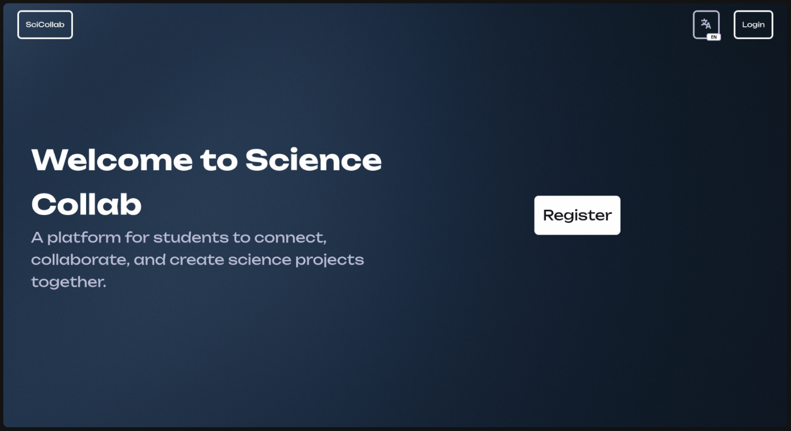
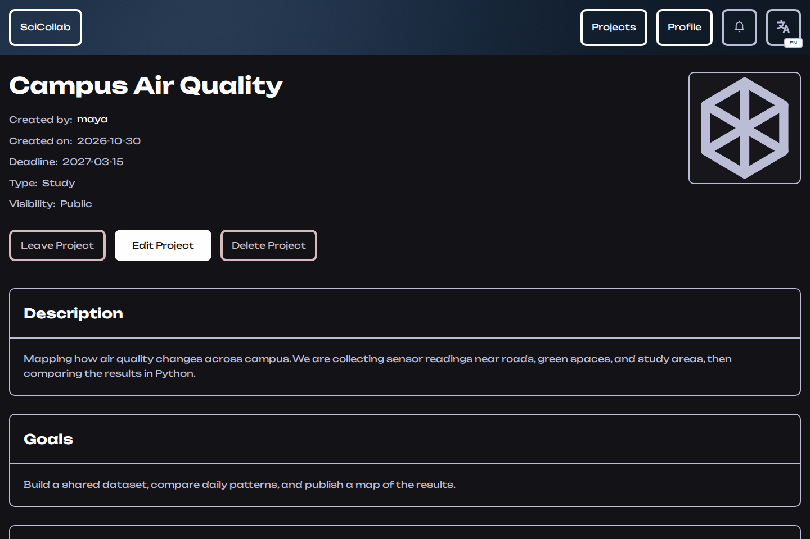
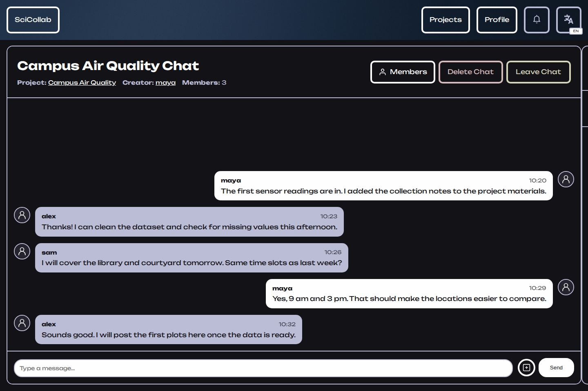

# SciCollab

A place for students to find research projects, build a team, and work together.
Create a project, review applications, share files, and keep the discussion in its own chat.
The interface is available in English and Russian.



## What it does

- Public and private projects, with a feed ranked by shared skills and interests.
- Applications and invitations, with separate creator, admin, and member permissions.
- Live project chats, file attachments, and notifications.
- Profiles with skills, research interests, and project memberships.

| Project page | Team chat |
| --- | --- |
|  |  |


## Built with

Python · Flask · SQLAlchemy · SQLite · Flask-Migrate · Socket.IO · Redis · Jinja2 · JavaScript

Project creation uses a single database transaction, uploads are served through
permission checks, and forms use CSRF protection.
Docker Compose includes Redis, persistent storage, and migrations at startup.

## Run locally

With Docker and Docker Compose installed:

```bash
cp .env.example .env
openssl rand -hex 32
```

Paste the generated value into `SECRET_KEY` in `.env`, then run:

```bash
docker compose up --build -d
```

Open **http://localhost:5000** and register an account.

For Python 3.11 setup without Docker, configuration, or upgrading an existing
database, see the [setup guide](docs/setup.md). Database and upload volumes survive
`docker compose down`; adding `-v` deletes them.

## Tests

With the Python environment from the setup guide activated:

```bash
python -m unittest discover -s tests -v
```

The suite covers authentication, project permissions, invitations, private downloads,
Socket.IO access, migrations, and transaction rollback. Tests use temporary databases
and uploads. Browser rendering checks are described in the
[testing notes](docs/setup.md#application-and-security-regression-tests).
